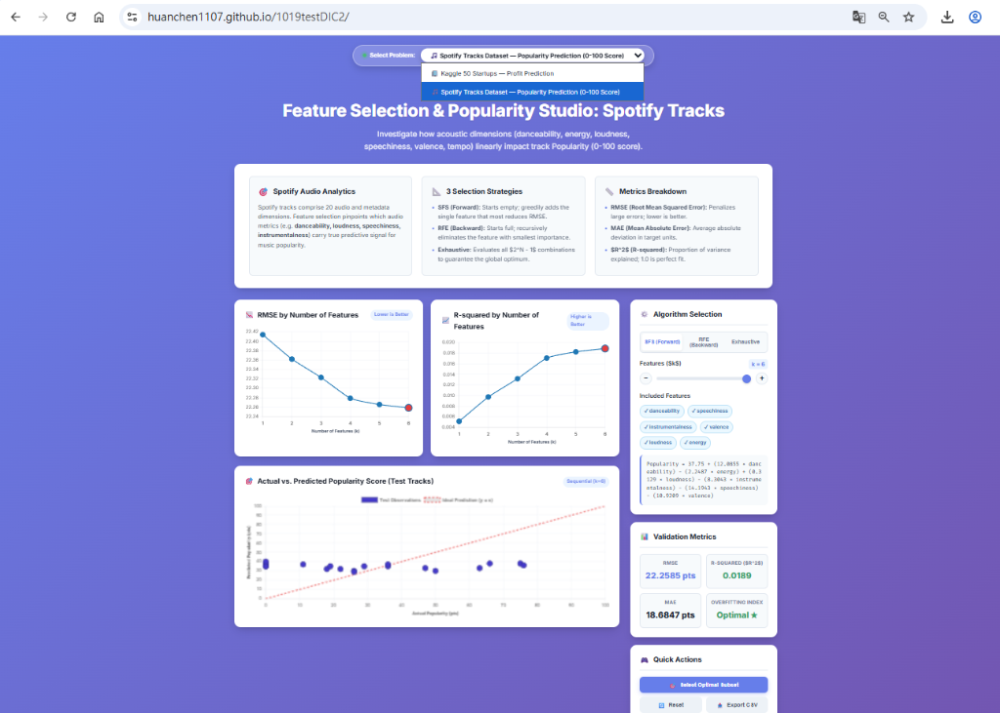

# 1019testDIC2: Interactive Feature Selection & Machine Learning Studio

[](https://huanchen1107.github.io/1019testDIC2/)

## 🌐 Live Demo
👉 **[https://huanchen1107.github.io/1019testDIC2/](https://huanchen1107.github.io/1019testDIC2/)**



An interactive machine learning laboratory and automated feature selection framework exploring:
1. **50 Startups Profit Prediction** (Regression on R&D, Marketing, Administration, and State)
2. **Spotify Tracks Popularity Prediction** (0–100 score prediction across acoustic dimensions: danceability, energy, loudness, speechiness, valence, tempo)

---

## 🚀 Features

- **End-to-End CRISP-DM Pipeline**:
  - **Business & Data Understanding**: Comprehensive data audit, distributions, outlier analysis, and correlation heatmaps.
  - **Data Preparation**: Group-aware imputation, one-hot encoding for categorical variables, and standard scaling.
  - **5 Feature Selection Methods**:
    1. **Exhaustive Feature Selection** (evaluates all $2^4 - 1 = 15$ feature combinations via 5-fold CV)
    2. **Sequential Forward Selection (SFS)** (greedy forward search minimizing CV RMSE)
    3. **Group-Aware RFECV** (recursive feature elimination preserving multi-level categorical features)
    4. **Lasso (L1 Regularization)** (hyperparameter-tuned via GridSearchCV)
    5. **Elastic Net (L1 + L2 Regularization)**
  - **Evaluation & Diagnostics**: OLS residual analysis, actual vs. predicted test performance ($R^2 \approx 0.90$).
  - **Model Deployment**: Exported pipeline to `startup_profit_pipeline.joblib`.

---

## 📦 Project Structure

```text
├── main.py                          # Complete CRISP-DM pipeline script
├── requirements.txt                 # Python dependencies
├── startup_profit_pipeline.joblib   # Trained and exported deployment model
├── .gitignore                       # Git ignore rules
├── README.md                        # Project documentation
└── plots/                           # Generated EDA and model diagnostic plots
    ├── eda_profit_distribution.png
    ├── eda_spending_vs_profit.png
    ├── eda_correlation_matrix.png
    ├── eda_profit_by_state.png
    ├── model_actual_vs_predicted.png
    └── model_residual_diagnostics.png
```

---

## 🛠️ Installation & Setup

1. **Clone the repository:**
   ```bash
   git clone https://github.com/huanchen1107/1019testDIC2.git
   cd 1019testDIC2
   ```

2. **Install dependencies:**
   ```bash
   pip install -r requirements.txt
   ```

3. **Run the pipeline:**
   ```bash
   python main.py
   ```
